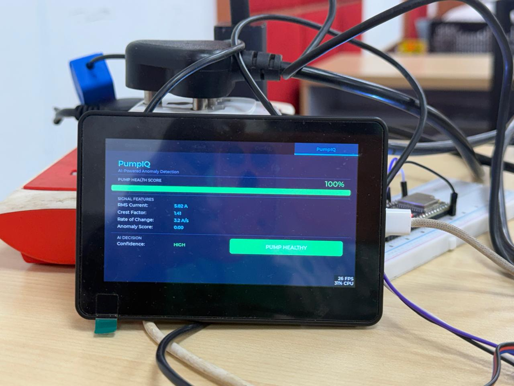
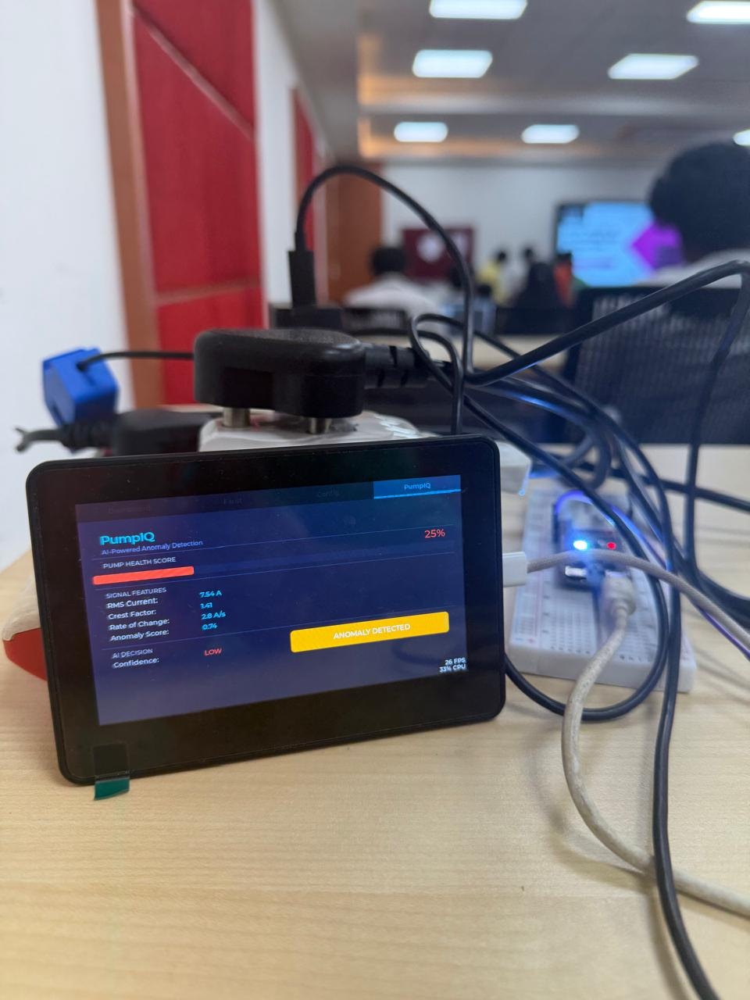
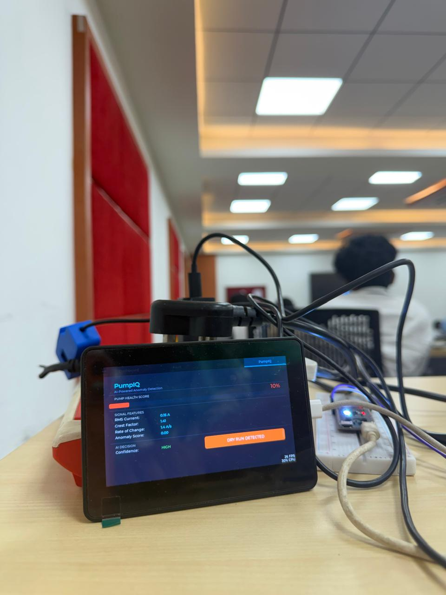
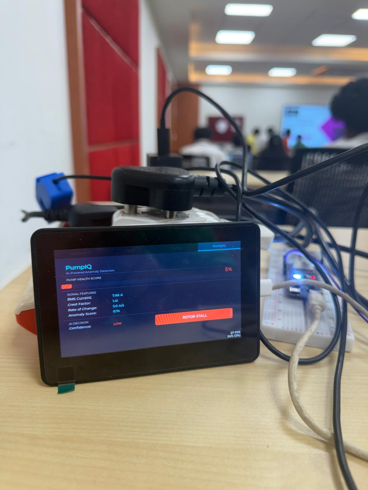

# PumpSentinel

**Edge-AI pump health monitoring on a ₹350 microcontroller. No cloud, no engineer, no failure.**

PumpSentinel clamps onto a pump's AC supply, learns what "normal" looks like for *that* pump at boot, and
flags dry run, mud ingestion and rotor stall in real time. Status is shown on a 4.3" touch HMI over
ESP-NOW (no router needed), and a confirmed stall can raise a maintenance work order through a webhook.

Built for the Makers Arena Hackathon 2026.

## Demo

Live HMI **PumpIQ** tab on the bench rig (sensor node on the breadboard, clamp-on current sensor on the supply):

| Healthy | Anomaly detected |
|:---:|:---:|
|  |  |
| **Dry run** | **Rotor stall** |
|  |  |

## System overview

```
 AC current clamp ──► SENSOR NODE (ESP32-S3)                        HMI NODE (Waveshare ESP32-S3 4.3" touch)
                      ADC 1 kHz → ring buffer                       ESP-NOW RX  → LVGL v8 UI
                      feature extraction                            Dashboard · Fault · Config · PumpIQ · CAFM
                      3-layer detection  ── ESP-NOW (10 Hz) ──►     config packets  ◄── back to sensor
                      alert manager
                          │
                          └── HTTP POST (rotor stall only) ──► n8n webhook ──► CAFM / work order
                                                         └── ESP-NOW job confirmation ──► HMI CAFM tab
```

### Detection pipeline (sensor node)

| Layer | Method | Catches |
|-------|--------|---------|
| Boot calibration | 32 samples at normal load build an in-memory Isolation Forest | Learns *your* pump, zero configuration |
| 1 | Z-score vs. calibrated baseline | Sudden load jumps |
| 2 | Isolation Forest (10 trees, depth 8) on RMS current, crest factor, rate of change | Subtle anomalies; score 0.0–1.0 |
| 3 | RMS-current signature zones | Dry run, mud ingestion, rotor stall |

Detected faults: **dry run**, **mud ingestion**, **rotor stall** (plus an anomaly warning). More
(blocked inlet, deadhead, overload, bearing wear, …) are on the roadmap.

## Repository layout

```
firmware/
  sensor_node/   ESP-IDF project – ADC sampling, feature extraction, detection, alerts, ESP-NOW TX
  hmi_node/      ESP-IDF project – LVGL touch UI, ESP-NOW RX
docs/
  architecture.md
  images/        bench photos used in this README
```

`main/shared_types.h` (the ESP-NOW packet definitions) is intentionally identical in both nodes – keep
the two copies in sync when you change the protocol.

## Hardware

| Part | Notes |
|------|-------|
| Sensor node | ESP32-S3 + AC current sensor (clamp-on) on ADC1 channel 6 (GPIO7), sampled at 1 kHz |
| HMI node | Waveshare ESP32-S3 4.3" touch LCD (800×480, GT911 touch, 16 MB flash, octal PSRAM) |

Indicative BoM is ₹5,000–6,000 with display; a display-less sensor node is roughly ₹1,500–2,000.

## Build & flash

Requires [ESP-IDF](https://docs.espressif.com/projects/esp-idf/en/latest/esp32s3/get-started/) **5.3.x**
(developed on v5.3.5) and Python. In an ESP-IDF PowerShell:

```powershell
# 1. Sensor node
cd firmware\sensor_node
idf.py set-target esp32s3
idf.py menuconfig        # "PumpSentinel Sensor Node": WiFi SSID/password + webhook URL
idf.py -p COM5 build flash monitor

# 2. HMI node (LVGL and the GT911 driver are pulled from the ESP component registry)
cd ..\hmi_node
idf.py set-target esp32s3
idf.py -p COM6 build flash monitor
```

Change `COM5` / `COM6` to your ports.

### Pairing the two nodes

ESP-NOW is peer-to-peer by MAC address. Each node logs its own MAC at boot. Set them to match your boards:

- `firmware/sensor_node/main/espnow_tx.h` → `HMI_MAC_ADDR` (the HMI's MAC)
- `firmware/hmi_node/main/espnow_rx.h` → `SENSOR_MAC_ADDR` (the sensor node's MAC)

Both use WiFi channel 1 (`ESPNOW_WIFI_CHANNEL`).

### Configuration & secrets

WiFi credentials and the alert webhook URL are set with `idf.py menuconfig` under **PumpSentinel Sensor
Node**. They are stored in `sdkconfig`, which is git-ignored, so no secret ever lives in source. The
defaults are placeholders.

Detection thresholds (`SIG_*`, `BASELINE_*`) are in `firmware/sensor_node/main/detection_engine.h` and were
set from bench calibration with a load bank on one pump (dry run ≤ 1.5 A, normal 5.0–6.6 A, warning 6.7–7.0 A, mud 7.1–7.5 A, stall ≥ 7.6 A) – **re-calibrate for your pump and current range**.

## Credits & licences

- Display/touch/LVGL port code (`lvgl_port.*`, `waveshare_rgb_lcd_port.*`) is adapted from Espressif and
  Waveshare examples under their original licences (see the SPDX headers in each file).
- UI built with [LVGL](https://lvgl.io) v8 (MIT).

## Licence

[MIT](LICENSE) © 2026 Adithya Venkatesh. Vendored or adapted third-party files (Espressif, Waveshare, LVGL) keep their own licences.
